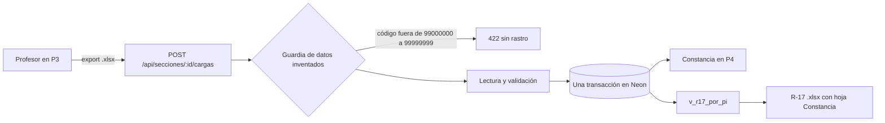

# Panorama del sistema de medición ABET

> Puerta de entrada a la documentación. Si se lee un solo documento antes de tocar el código, conviene que sea este.

> **Estado 2026-10-28.** Describe el producto mínimo viable (minimum viable product, MVP) «Del export de Blackboard al R-17 desde la base» (épica EP-01), en revisión por Jefferson. Lo marcado «(propuesta)» todavía no está decidido.

---

## 1. El contexto

La Carrera de Ingeniería Ambiental de la Universidad de Lima mide, en cada sección, el logro de los resultados del estudiante (student outcomes, SO) a través de sus indicadores de desempeño (performance indicators, PI). El profesor califica los PI en Blackboard con una rúbrica, descarga el libro de calificaciones como export y entrega un reporte R-17 por sección, que es la evidencia que leen la Oficina de Calidad y el evaluador de ABET (Accreditation Board for Engineering and Technology).

Hoy el profesor sube su export a un cuaderno de Colab que vacía las celdas inválidas sin dejar rastro, adivina la sección por el nombre de la hoja y no guarda nada. Con ese camino nadie puede decir de qué archivo sale un R-17 ni qué base lo respalda.

### El pedido que ordena el MVP

El pedido literal de Jefferson del 2026-10-28 es el siguiente.

> «Debemos desarrollar un sistema completo para poder subir el export de blackboard y este mismo que permita generar el excel (R17) para el profesor como evidencia de que se subió correctamente el export con sus datos. Y así mismo de que se pudo subir a la base de datos.»

De ese pedido salen, en este orden, los cuatro resultados del MVP. La base vive en la nube (Neon), el profesor sube el export, sus datos quedan cargados en la base y el R-17 se genera desde la base, con la constancia de la carga como evidencia para el profesor.

---

## 2. Los actores

| Actor | Qué hace en el MVP | Qué ve |
|---|---|---|
| Profesor de la sección | Sube el export de la sección que `acceso.docente_seccion` le asigna, revisa el resultado y descarga el R-17 con su constancia | Solo sus secciones del periodo vigente |
| Coordinador de la carrera | Es dueño de los datos de la base (secciones, plan de medición, docentes por sección y reglas), ve todas las secciones y descarga cualquier R-17. En el corte 1 no sube exports, y en el corte 2 puede reemplazar la carga de cualquier sección (US-18) | Todas las secciones de Ambiental |
| Administrador técnico (Jefferson) | Migra la base, crea el rol de la aplicación, siembra los datos inventados, registra a los usuarios y despliega | No usa la aplicación en el día a día |
| Evaluador de ABET y Oficina de Calidad | No usan el sistema en el MVP y reciben el R-17 como evidencia | Nada dentro del sistema |

La regla de visibilidad la fija Jefferson con la frase «los de arriba pueden ver hacia abajo, pero no los de abajo hacia arriba». La historia US-06 es su única dueña.

---

## 3. El corazón del sistema

Una carga es la lectura de un export para una sección. El programa `abet_carga` del Back lee el archivo, cuenta sus filas antes de interpretarlas, rechaza las filas inválidas con su motivo y escribe el archivo, la carga, sus columnas, sus filas, sus estudiantes y sus mediciones en una sola transacción. O entra todo, o no entra nada.

Dos barreras protegen la base. La primera es el programa, que valida antes de escribir. La segunda son las restricciones y los índices únicos parciales de la base, como la restricción `ck_carga_conciliada` (una carga publicada lee tantas filas como trae el archivo) o el índice `uq_carga_publicada_por_seccion` (una sola carga publicada por sección), que detienen un defecto del programa aunque la validación falle.

El R-17 nunca recalcula el archivo. Sus porcentajes salen de la vista `abet.v_r17_por_pi`, que solo ve cargas en estado PUBLICADA. Con el export de prueba que trae un 5 en la columna del PI 5.2 en la fila 3, la carga lee 11 filas, acepta 10 y rechaza 1 con el motivo NIVEL_FUERA_DE_ESCALA. Con esa carga, el R-17 muestra 60,0 % (6 de 10), 60,0 % (6 de 10) y 70,0 % (7 de 10) en los PI 5.1, 5.2 y 5.3, frente a una meta de 80 %, con la franja PROVISIONAL.

---

## 4. Alcance actual

### Lo que el MVP hace

El MVP cubre 21 historias en dos cortes. El corte 1 (US-01 a US-17) entrega los cuatro resultados de Jefferson.

| Bloque | Historias |
|---|---|
| Base en Neon, rol de la aplicación, periodo 2026-2 con datos inventados, usuarios y docentes por sección | US-01 a US-04 |
| Ingreso con contraseña asignada y lista de las secciones al alcance del usuario | US-05 y US-06 |
| Subida del export en una transacción, guardia de datos inventados, archivo ya cargado, filas inválidas, archivo ilegible, estructura, otra sección y descarte de nombres | US-07 a US-14 |
| R-17 desde la base y constancia de la carga | US-15 y US-16 |
| Despliegue en Vercel con Neon y prueba de punta a punta | US-17 |

El corte 2 completa el MVP antes del primer profesor externo. Suma el reemplazo de una carga publicada (US-18), la lista de las cargas al alcance del usuario (US-19), el código de acceso por correo institucional (US-20) y la confirmación de la sección cuando el archivo no la declara (US-21).

### Lo que queda fuera

El sistema todavía no verifica un export ni un R-17 contra la base, no cierra las cargas del periodo, no aprueba un conjunto de reglas, no reprocesa cargas con reglas aprobadas y no admite al estudiante medido en dos secciones del mismo curso. Tampoco trae pantallas de administración para coordinadores (en el MVP son scripts), inicio con cuenta Microsoft, Power BI leyendo Neon ni el R-18.

Los datos reales también quedan fuera, porque esperan la autorización de la universidad (Ley 29733 y DS 016-2024-JUS).

---

## 5. Glosario

Ordenado desde el archivo que sube el profesor hasta la evidencia que recibe la Oficina de Calidad.

- **Export.** Libro .xlsx que Blackboard produce desde el centro de calificaciones. Trae una hoja con el encabezado en la fila 1 y una fila por estudiante. El sistema solo lee el código de la columna Username y las columnas de PI del plan.
- **Sección.** Grupo de una asignatura en un periodo, como la 410 de 450002 en 2026-2. Vive en `abet.seccion` y la elige el profesor, nunca el archivo.
- **SO y PI.** El resultado del estudiante (SO 5, por ejemplo) y su indicador de desempeño («5.1»). Viven en `abet.so` y `abet.pi`.
- **Plan de medición.** Qué PI mide cada asignatura en un periodo. Vive en `abet.plan_medicion`, y sin él la base rechaza cualquier columna de PI.
- **Nivel.** Calificación de 1 a 4 de un estudiante en un PI. `ck_medicion_nivel` impide guardar otro valor.
- **Carga.** Lectura de un export para una sección, con estado EN_CURSO, RECHAZADA, PUBLICADA o REEMPLAZADA. Vive en `abet.carga`.
- **Huella.** SHA-256 de los bytes originales del archivo. Vive en `abet.archivo_origen.sha256` y reconoce un export ya cargado aunque cambie de nombre. El nombre del archivo, sin ruta, vive en `abet.archivo_origen.nombre_archivo`.
- **Rechazo y aviso.** Motivo por el que una fila o una carga entera queda fuera (RECHAZA_FILA o RECHAZA_CARGA), o una advertencia que no detiene la carga (AVISO). Vive en `abet.rechazo_fila`, que nunca guarda el valor leído.
- **Guardia de datos inventados.** Regla que rechaza todo export con un código fuera de 99000000 a 99999999, en la API con `GUARDIA_DATOS_INVENTADOS=1` y en la base de Neon con `ck_estudiante_codigo_inventado`.
- **Conjunto de reglas.** Versión de los parámetros que usa una carga, como META_LOGRO 0,80 y NIVEL_ESPERADO 3 en R-2026-BORRADOR. Vive en `abet.conjunto_reglas` y `abet.parametro_valor`.
- **Provisional.** Marca del R-17 mientras el conjunto de reglas de la carga no está APROBADO con NIVEL_ESPERADO, META_LOGRO y TRATO_SIN_EVIDENCIA DEFINIDOS. Sale de la columna `provisional` de `v_r17_por_pi`.
- **R-17.** Reporte por sección con la cabecera, los SO y PI medidos, los conteos por nivel, el porcentaje de logro frente a la meta y la tabla de estudiantes con su código. Su nombre sigue la forma `R017_450002_410_2026-2_PROVISIONAL.xlsx`.
- **Constancia.** Prueba de la carga que recibe el profesor, en la pantalla P4 y en la hoja «Constancia» del R-17, con el archivo, la hoja, la huella, las filas, el estado, las fechas, la versión del programa, el conjunto de reglas, los avisos y los rechazos por motivo y fila.

---

## 6. Mapa de la documentación

| Carpeta | Pregunta que responde | Primer documento |
|---|---|---|
| `00-vision/` | Qué es el sistema, para quién y por qué se decide así | `panorama.md` |
| `00-vision/adr/` | Qué decisiones son difíciles de revertir y cómo se comprueban | `adr/README.md` |
| `01-arquitectura/` | Qué pantallas hay, qué historia las justifica y cómo hablan con la API | `frontend.md` |
| `03-api/` | Qué rutas expone el Back, con qué cuerpo, respuesta y errores | `contrato.md` |
| `05-operacion/` | Dónde corre cada pieza, con qué variables y cómo se despliega | `entornos-y-despliegue.md` |
| `specs/` | En qué orden se trabaja una funcionalidad y dónde está su spec | `workflow.md` |

Esta documentación explica, sin reemplazarlas, cuatro fuentes de referencia del Back. Son las migraciones de `db/`, la spec aprobada del MVP en `specs/001-mvp-carga-r17/spec.md`, las specs vivas de `specs/features/` y los `.feature` de `specs/001-mvp-carga-r17/aceptacion/`. Cuando un documento y el código discrepan, gana el código, y cuando un documento y esas fuentes discrepan, ganan las fuentes.

---

## 7. Antes de tocar el código

1. Leer `MEMORIA.md` y `AGENTS.md` del repositorio donde se trabaja.
2. Ubicar la historia que pide el cambio en la spec aprobada. Si ninguna historia lo pide, no se implementa ni se muestra en pantalla.
3. Usar solo datos inventados, con códigos de estudiante de 99000000 a 99999999, y nunca mostrar nombres de estudiantes.

---

## 8. Lo que todavía NO está

1. **La spec aprobada.** Las 21 historias y sus escenarios esperan el merge (la fusión del PR) de la spec en `develop` del Back, y la constitución del Back espera la ratificación de Jefferson.
2. **Las decisiones de Jefferson.** Siguen abiertas, con su valor recomendado, J-01 (FastAPI), J-02 (un solo rol `abet_app`), J-03 (contraseña asignada), J-07 (Vercel Hobby, con la consulta a soporte por el uso no comercial) y J-09 (la prueba de humo en la CI o contra Preview), entre otras de la spec.
3. **Las decisiones de la carrera.** Siguen abiertas, con valor provisional, trece decisiones. Las de la carga son la celda inválida (D-01, se rechaza la fila completa), la sección no declarada (D-02, 422 en el corte 1 y confirmación en el corte 2), el texto «-» o «NP» (D-03, NIVEL_NO_NUMERICO), el Total Pts distinto de 4 (D-04, aviso) y los niveles -1, 0 y 5 (D-06, NIVEL_FUERA_DE_ESCALA). Las demás, de D-05 y D-07 a D-13, están en la tabla de decisiones abiertas de la spec.
4. **El tipo de curso.** El MVP solo llena la hoja «Cursos de Carrera» del R-17, porque la base todavía no sabe si un curso es Capstone.
5. **El nombre del profesor y la descripción del instrumento en el R-17.** La base no los guarda en V1_01 a V1_08.
